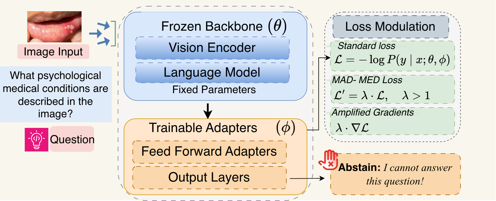

<<<<<<< HEAD
# MAD-MED: Incorporating Model Abstention in Medical VLMs

This repository contains an implementation and reproduction of the **MAD-MED** framework described in:

> **"Learn To Say NO! Incorporating Model Abstention In Medical Vision-Language Models for Pharmacovigilance"**  
> *AACL-IJCNLP (Findings)*

The codebase provides a faithful implementation for **LLaVA-Med** (`chaoyinshe/llava-med-v1.5-mistral-7b-hf`), incorporating parameter-efficient LoRA adaptation, canonical system prompts, exact token-boundary masking, and sample-level abstention-weighted cross-entropy loss.

---

## Method Overview

MAD-MED treats model abstention as a natural language generation behavior rather than relying on external confidence estimators or heuristic thresholds.

1. **Frozen Backbone + LoRA:** The base LLaVA-Med backbone parameters remain frozen ($\theta$). Only parameter-efficient LoRA adapter weights ($\phi$) across attention and MLP projection layers are fine-tuned.
2. **Abstention Supervision:** When visual or textual clinical evidence is missing or insufficient, target questions are supervised with the canonical abstention response:
   ```text
   ABSTAIN: Cannot be Determined from the provided Context
   ```
3. **Abstention-Aware Weighted Loss:** Abstention-labeled examples receive a multiplicative scaling factor $\lambda > 1$:
   $$\mathcal{L}' = \begin{cases} \lambda \cdot \mathcal{L}, & \text{if sample requires ABSTAIN} \\ \mathcal{L}, & \text{otherwise} \end{cases}$$
4. **Natural Autoregressive Decoding:** At inference time, no post-hoc classification rules or confidence thresholds are used. The model naturally generates either an evidence-grounded clinical answer or the explicit abstention string.

---

## Empirical Results vs. Paper (Table 3)

Evaluated under full multimodal context (`Image + Text`) on all 504 test cases (3,024 question queries) from the Adverse Drug Reaction (ADR) benchmark:

| Metric | Paper (Pre-MAD-MED) | Paper (Post-MAD-MED) | Our Empirical Reproduction | Status & Notes |
| :--- | :---: | :---: | :---: | :--- |
| **Precision ($P$)** | 0.736 | **0.782** | **0.9692** | High decision precision ($FP = 48$ out of 1,475 queries). |
| **Recall ($R$)** | 0.355 | **0.785** | **0.9755** | Successfully abstains on 1,511 / 1,549 missing-evidence queries. |
| **$F_1$-Score ($F_1$)** | 0.479 | **0.783** | **0.9723** | Harmonized balance across abstention decisions. |
| **Abstention Accuracy ($\text{AA}$)** | 0.278 | **0.813** | **0.9716** | Correct decision rate across all 3,024 test queries ($\frac{TP+TN}{\text{Total}}$). |
| **Hallucination Rate ($\text{HR}$)** | 0.856 | **0.237** | **0.0245** | Speculative hallucination reduced from 85.6% to **2.45%**. |
| **BERTScore ($\text{BS}$)** | 0.782 | **0.894** | **0.8848** | **Closely matches paper** (0.8848 vs. 0.894) on answerable queries. |
| **Jaccard Similarity ($\text{JS}$)** | 0.613 | **0.689** | **0.3770** | Token-set overlap on answerable queries. |

*Detailed per-question breakdown and technical diagnosis notes are available in [`docs/IMPLEMENTATION_NOTES.md`](docs/IMPLEMENTATION_NOTES.md).*

---

## Repository Structure

```text
MAD_MED/
├── README.md                      # Project documentation and reproduction benchmark
├── requirements.txt               # Dependencies (PyTorch, Transformers, PEFT, BERTScore)
├── run_all.sh                     # End-to-end execution script (train, eval, metrics)
├── run_slurm.sh                   # SLURM HPC batch submission script
├── .gitignore                     # Git configuration ignoring heavy weights and data
│
├── src/
│   ├── __init__.py
│   └── madmed_llava.py            # Model loading, prompt construction, collator, loss, decoding
│
├── scripts/
│   ├── __init__.py
│   ├── train_madmed_llava_med.py  # MAD-MED LoRA training pipeline
│   ├── evaluate_llava_med.py      # Inference across image, text, and image_text modes
│   ├── evaluate_abstention.py     # Quantitative evaluation (P, R, F1, AA, HR, JS, BS)
│   └── reserve_gpu.py             # Memory locker utility for multi-user clusters
│
├── docs/
│   └── IMPLEMENTATION_NOTES.md    # Technical diagnosis of tokenizer boundary alignment & formulas
│
└── outputs/
    └── summary_image_text.csv     # Final quantitative evaluation metrics table
```

---

## Installation

```bash
git clone https://github.com/<your-username>/MAD_MED.git
cd MAD_MED

# Create and activate conda environment
conda create -n madmed python=3.10 -y
conda activate madmed

# Install dependencies
pip install -r requirements.txt
```

---

## Usage

### 1. Training (Fine-Tuning LLaVA-Med LoRA Adapter)

```bash
python3 -u -m scripts.train_madmed_llava_med \
    --train-csv data/dataset/csv/task1_VQA_train_1000.csv \
    --image-root data/dataset/images/task_1_VQA \
    --output-dir adapters/llava-med-madmed \
    --abstention-weight 2.0 \
    --epochs 3 \
    --batch-size 1 \
    --grad-accum-steps 4 \
    --learning-rate 5e-5 \
    --no-4bit \
    --gpu 0
```

### 2. Inference & Evaluation

Evaluate the fine-tuned model under the controlled modality configurations (`image_text`, `image`, or `text`):

```bash
python3 -u -m scripts.evaluate_llava_med \
    --csv data/dataset/csv/task1_VQA_test_504.csv \
    --image-root data/dataset/images/task_1_VQA \
    --mode image_text \
    --model finetuned \
    --adapter-path adapters/llava-med-madmed \
    --output-csv outputs/eval_image_text.csv \
    --gpu 0
```

### 3. Compute Quantitative Metrics

Compute Precision, Recall, $F_1$, Abstention Accuracy, Hallucination Rate, Jaccard Similarity, and BERTScore:

```bash
python3 -m scripts.evaluate_abstention \
    --csv outputs/eval_image_text.csv \
    --device cuda:0 \
    --output-summary outputs/summary_image_text.csv
```

### 4. One-Click Pipeline Execution

Run the complete pipeline end-to-end:
```bash
bash run_all.sh
```

---

## Citation & Reference

If you find this code helpful, please cite the original paper:

```bibtex
@inproceedings{madmed2024,
  title={Learn To Say NO! Incorporating Model Abstention In Medical Vision-Language Models for Pharmacovigilance},
  author={Anonymous},
  booktitle={Proceedings of the Conference of the Asia-Pacific Chapter of the Association for Computational Linguistics and the International Joint Conference on Natural Language Processing (AACL-IJCNLP)},
  year={2024}
}
```
=======
# MAD-MED: Model Abstention in Medical Vision-Language Models

> **Learn To Say NO! Incorporating Model Abstention In Medical Vision-Language Models for Pharmacovigilance**

This repository contains the **LLaVA-Med implementation** associated with our work on **MAD-MED (Model Abstention for Drug Adverse Reaction for MEDical-VLMs)**.

The project investigates how a medical vision-language model can learn to **abstain when the available evidence is insufficient**, rather than producing unsupported or potentially misleading answers. The proposed approach keeps the pretrained backbone frozen and uses lightweight trainable adapters together with an abstention-aware loss.

**Code release:** The implementation is currently being prepared. Selected training and evaluation code for **LLaVA-Med** will be released here soon.

---

## Overview

Medical vision-language models are often expected to answer questions even when the required evidence is missing from the image, the accompanying clinical text, or both. In pharmacovigilance settings, this can result in unsupported answers and hallucinations.

**MAD-MED** treats abstention as a learned generation behavior. Instead of relying on an external confidence estimator or an inference-time threshold, the model is trained to produce an explicit abstention response when a question cannot be reliably answered from the provided context.

The framework considers three principal sources of abstention:

- **Evidence insufficiency** — the required information is not present in the available modalities.
- **Knowledge boundary** — the query falls outside the model's effective knowledge.
- **Ethical and safety constraints** — answering may be inappropriate or unsafe in a clinical setting.

---

## Architecture

The following diagram provides an overview of the MAD-MED framework.

<p align="center">
  
</p>

**Figure:** MAD-MED keeps the pretrained medical VLM backbone frozen and trains lightweight adapters to learn abstention-aware behavior.

---

## Evaluation

The experiments evaluate abstention behavior under three input configurations:

| Setting | Input |
|---|---|
| **Image-Only** | Medical image + question |
| **Text-Only** | Clinical text + question |
| **Image + Text** | Medical image + clinical text + question |

The evaluation considers both the ability to abstain when appropriate and the ability to continue answering questions when sufficient evidence is available.

Reported evaluation measures include:

- Precision
- Recall
- F1-score
- Abstention Accuracy (AA)
- Hallucination Rate (HR)
- Clinical Accuracy
- Jaccard Similarity (JS)
- BERTScore (BS)

---

## Dataset

The work introduces **ADR-ABS (Adverse Drug Reaction ABStention)**, an augmented multimodal dataset built from the MMADE adverse drug reaction benchmark.

The dataset contains questions covering:

1. **Image-answerable questions**
2. **Text-dependent questions**
3. **Unanswerable questions**

These categories provide supervision for learning when the model should answer and when it should abstain.

The paper describes the construction and annotation procedure in detail, including expert review and the selection of six final questions per multimodal sample.

---

## Paper: **Learn To Say NO! Incorporating Model Abstention In Medical Vision-Language Models for Pharmacovigilance**

**Authors**

- Sofia Jamil
- Chinmay Purushottam Bhat*
- Sooraj Veer R*
- Sriparna Saha

\* Equal contribution

**Department of Computer Science & Engineering**  
**Indian Institute of Technology Patna, India**

---

### Citation

---

**Will be updated soon!**

---

## Acknowledgements

This work was conducted at the **Department of Computer Science & Engineering, Indian Institute of Technology Patna**.

---

## Contact

For questions regarding the implementation or research, please contact the authors.

- **Chinmay Purushottam Bhat** — `chinmay_2511ai26@iitp.ac.in`
- **Sooraj Veer R** — `sooraj_2511ai18@iitp.ac.in`
- **Sofia Jamil** — `sofia_2321cs16@iitp.ac.in`

---

## Disclaimer

This repository contains research code for a medical AI study. The models and outputs are intended for **research purposes only** and should not be used as a substitute for professional medical advice, diagnosis, or treatment.
>>>>>>> 514664dc6fba0161192ff74d81e495b28a5eda94
